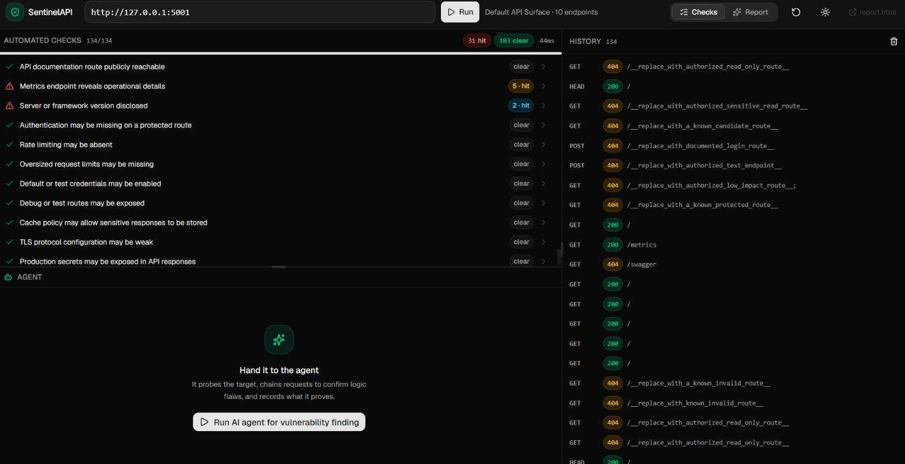

# SentinelAPI — Zero-Trust API Vulnerability Scanner

> "Find the API vulnerability before the breach headline does."
> AmiHacks hackathon submission by **Team 0dayTM** (Track C — Industry / Deep-Tech, Problem Statement 3).

SentinelAPI scans an API target in two passes:

1. **Pass 1 — Deterministic static engine:** spec-aware curl probes + regex/content matching. No LLM, no network dependency beyond the target. Fast, reproducible, explainable.
2. **Pass 2 — Agentic pentester (DeepSeek):** an LLM loop with safe tools (`run_curl`, `record_finding`, `finish_scan`) that chains requests to confirm multi-step / logic flaws (BOLA, auth bypass, data exposure) and writes evidence to `findings.md`.

Results are surfaced in a **Burp-lite style React dashboard** (tests, HTTP history, agent chat, scored report) plus a static `report.html` export.



## How it works

```
[UI: target origin or uploaded OpenAPI spec]
        |
        v
Pass 1: Static engine (src/staticChecker.tsx + src/static_checker.json)
  resolve spec -> enumerate surface -> run ~100+ curl/regex checks -> findings + history
        |
        v
Pass 2: Agent loop (src/agent.ts, DeepSeek via @earendil-works/pi-agent-core)
  read /openapi.json -> plan -> run_curl -> observe -> record_finding -> finish_scan
        |
        v
[Dashboard] Tests | HTTP history | Agent chat | Report (score, severity, evidence, fixes)
```

Key design points:

- **Spec-first, not wordlist-first:** `src/swagger.ts` enumerates `method + path` pairs from the OpenAPI document (path params filled from `example`), so the site map and checks stay scoped to the real surface. Bare origins fall back to `src/default_swagger.json`.
- **One shared history log:** static probes and agent traffic both go through `src/history.ts` (`data/history.jsonl`), so the UI shows a single Burp-style request/response + LLM-call log.
- **Bounded agent context:** only the last N messages plus a re-read `<confirmed_findings>` block from `findings.md` reach the model; the full transcript is still persisted under `data/sessions/`.
- **Report is schema-fill, not prose:** the model fills a strict JSON schema (`src/report.ts`), rendered by the dashboard and exported deterministically to `report.html` / `data/report.json`.

## Demo target (deliberately vulnerable)

`src/server.ts` is the thing you scan — **not** the tool backend. It runs on `http://127.0.0.1:5001` and contains seeded bugs:

| Route | Bug |
|---|---|
| `GET /api/users/{id}` | Excessive data exposure (`password_hash`, `ssn`, `api_key`, `internal_notes`), no auth |
| `GET /api/orders/{id}` | BOLA — any caller reads any order, no owner check |
| `GET /api/admin/config` | Missing auth on privileged config (leaks `signing_key`) |
| `GET /api/search` | Ignores `q`, unbounded `page_size`, cross-tenant dump |
| `POST /api/login` | Accepts any/empty credentials, returns static `demo-access-token` |
| `GET /api/debug/error` | Verbose SQL + stack trace + filesystem path |
| `GET /health`, `/version`, `/metrics`, `/openapi.json`, `/docs` | Internal hostnames, build metadata, unprotected schema/docs |
| All responses | Wildcard CORS, `Server` / `X-Powered-By` banners, weak static `session` cookie (no `Secure`/`HttpOnly`/`SameSite`), missing HSTS/CSP/nosniff/XFO |

Its OpenAPI description is `src/openapi.json` (also served at `/openapi.json`); root `swagger.json` is a copy for tooling.

## Repo layout

```
src/
  server.ts            # vulnerable demo target (:5001)
  api.ts               # tool backend (:5000, SSE: /api/spec, /api/scan, /api/agent, /api/report, /api/history)
  scan.ts              # CLI: static scan entry point
  agent.ts             # CLI + library: DeepSeek agent loop, curl guardrails, sessions
  agent-selftest.ts    # offline self-test (faux model, no API key needed)
  staticChecker.tsx    # rule runner: curl templating, regex matching, history logging
  static_checker.json  # ~100+ deterministic checks (headers, CORS, cookies, errors, GraphQL, TLS, …)
  checks.demo.json     # small rule subset for quick demos
  swagger.ts           # spec loading / surface enumeration / origin resolution
  history.ts           # shared HTTP + LLM history log
  session.ts           # persisted agent conversations (data/sessions/)
  report.ts            # report schema, LLM fill, HTML/JSON export
  openapi.json / default_swagger.json
ui/                    # React + Vite + Tailwind dashboard (onboarding, tests, history, agent, report)
  src/components/dashboard/  TestsPanel, HistoryPanel, AgentPanel, TopBar
  src/components/report/     ReportDashboard, ReportDetail, ReportCards
  src/components/onboarding/ spec-or-URL entry flow
data/ history.jsonl, report.json, sessions/
findings.md            # agent-confirmed findings (evidence of record)
report.html            # generated export
plan.md                # original build plan / demo script
sentinelapi-architecture.excalidraw
```

## Prerequisites

- [Bun](https://bun.sh/) v1.3.x (backend, scanner, agent, demo target)
- Node-compatible env for `ui/` (Bun works: `cd ui && bun install`)
- A [DeepSeek API key](https://platform.deepseek.com/api_keys) — only needed for the agent and report generation, not for static scans

## Setup

```bash
cp .env.example .env
# edit .env: DEEPSEEK_API_KEY, DEEPSEEK_MODEL (default deepseek-flash),
#            TARGET_URL (default http://127.0.0.1:5001),
#            FINDINGS_PATH, AGENT_MAX_TURNS, AGENT_CONTEXT_MESSAGES
bun install
cd ui && bun install
```

## Running (3 processes)

```bash
# 1. Vulnerable demo target  -> http://127.0.0.1:5001
bun run target

# 2. Tool backend            -> http://127.0.0.1:5000
bun run api

# 3. Dashboard (dev)         -> http://127.0.0.1:5173
bun run ui
```

Open the UI, pick **spec upload** or **target URL**, then Run scan → Start agent → View report.

## CLI usage

```bash
# Static scan only (no key needed). Exit code 2 = findings.
bun run scan http://127.0.0.1:5001
bun run scan src/openapi.json --url http://127.0.0.1:5001
bun run scan http://127.0.0.1:5001 --checks src/checks.demo.json --json --verbose

# Agent assessment (needs DEEPSEEK_API_KEY)
bun run agent
bun run agent http://127.0.0.1:5001
bun run agent --sessions
bun run agent --resume last "why is the order route the worst one?"

# Offline verification (no key, needs demo target running)
bun run selftest
```

## Backend API

| Route | Method | Purpose |
|---|---|---|
| `/api/spec` | POST | Parse uploaded OpenAPI → title, origin, surface |
| `/api/scan` | POST (SSE) | Run static rules, streams `start`/`running`/`result`/`done` |
| `/api/agent` | POST (SSE) | Start/continue agent session, streams tokens + tool logs |
| `/api/report` | POST (SSE) / GET | Generate report from `findings.md` + last static scan / fetch last report |
| `/api/history` | GET | `?kind=http\|llm`, unified probe + model-call log |
| `/report.html` | GET | Generated static report |

## Configuration (`.env`)

| Var | Default | Purpose |
|---|---|---|
| `DEEPSEEK_API_KEY` | — | Required for agent + report |
| `DEEPSEEK_MODEL` | `deepseek-flash` | Legacy `deepseek-v4-flash*` names resolve here too |
| `TARGET_URL` | `http://127.0.0.1:5001` | Origin the agent is scoped to (origin-checked on every curl) |
| `FINDINGS_PATH` | `findings.md` | Where confirmed findings append |
| `AGENT_MAX_TURNS` | `20` | Hard stop on the agent loop |
| `AGENT_CONTEXT_MESSAGES` | `20` | Recent messages sent per model call |

Agent safety: no shell — curl strings are tokenized to argv; only `curl` allowed; file flags (`-o/-T/-K/-c/…`, `@file`) rejected; request origin must equal the session target. `finish_scan`, a bare `STOP` reply, or the turn budget ends the run.

## Outputs

- `findings.md` — agent-confirmed vulnerabilities with curl evidence + remediation (the evidence of record).
- `data/report.json` + `report.html` — scored assessment (0–100, grade A–F; Critical −25, High −15, Medium −6, Low −2), severity distribution, top types, coverage gaps, prioritized fixes.
- `data/history.jsonl` — every probe and model call; `data/sessions/` — resumable transcripts.

## 2-minute demo

1. Scan the demo target → static hits + severity-ranked tests.
2. Start the agent → watch `run_curl` confirm BOLA/auth-bypass/PII leaks into `findings.md`.
3. Open History → click a probe for full request/response.
4. Chat: `"prove BOLA on /api/orders/1"` → agent re-fires the exploit.
5. Report tab → score/grade, evidence cards, copy-paste curls, `report.html` export.

See `plan.md` for the full build plan and scope cuts.

## Troubleshooting

- `DEEPSEEK_API_KEY is not set` → `cp .env.example .env` and add the key (static scan + selftest work without it).
- Agent refuses a curl as off-origin → the session target is pinned at creation; start a new session for a new host.
- SSE streams cut early → `src/api.ts` sets `idleTimeout: 240`; check proxies buffering event streams.
- UI shows no surface → upload a JSON OpenAPI doc (YAML is rejected — convert to JSON first) or use a bare origin to fall back to `default_swagger.json`.
